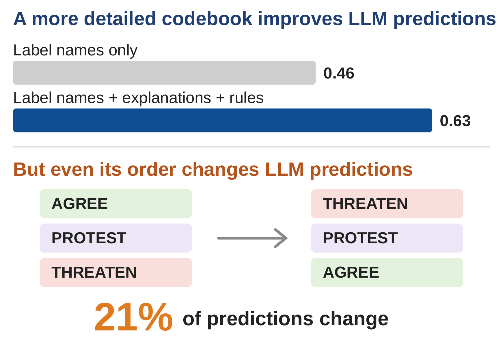
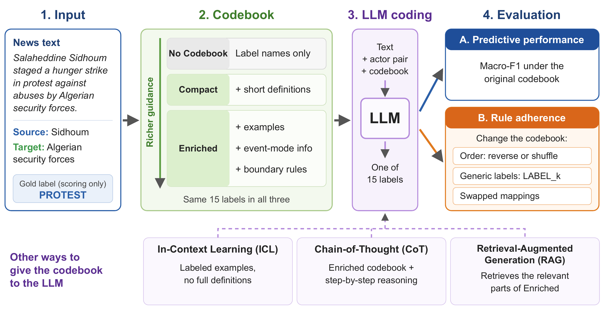

# When Better Codebooks Are Not Enough

Code for **When Better Codebooks Are Not Enough: Predictive Performance and Rule Adherence in LLM Political Event Coding** (EACL 2027, Main Conference).

Zixian He (Independent Researcher) · Bharath Raahul Murugesan (Illinois Institute of Technology) · Patrick T. Brandt (The University of Texas at Dallas) · Yibo Hu (Illinois Institute of Technology)

📄 [arXiv:2606.06781](https://arxiv.org/abs/2606.06781)

## Key finding

<table>
<tr>
<td width="52%">
Clearer codebooks make LLMs better event coders, but higher accuracy does not show that a model follows the codebook.
<br><br>
On PLV source-target event coding with 15 PLOVER root labels, mean macro-F1 across four open-source LLMs rises from <b>0.457</b> with label names alone to <b>0.574</b> with short definitions and <b>0.633</b> with an enriched codebook.
<br><br>
Yet reversing the order of entries in the enriched codebook, with every label and definition unchanged, changes <b>21.2%</b> of predictions.
<br><br>
LLM-generated labels used as social-science data should be checked for both predictive performance and responses to codebook changes.
</td>
<td width="48%" valign="middle">

</td>
</tr>
</table>

## Framework

<p align="center"></p>

Each example is coded under three codebooks that share the same 15 labels but give increasingly detailed guidance. We then evaluate (A) predictive performance under the original codebook and (B) rule adherence, by changing the codebook and checking whether predictions follow the change.

## Quick start

```bash
# Part II: codebook-change probes (Hugging Face models)
cd part2_behavioral_probes
pip install -r requirements.txt
python run.py --make-dataset-splits --split-builder-datasets plover,aw
python run.py --model meta-llama/Meta-Llama-3.1-8B-Instruct --datasets plover --limit 20

# Part I: predictive evaluation (Ollama)
cd ../part1_predictive_evaluation
ollama pull gemma2:9b
python3 primary/plover_predictive_experiments.py --step llm_enriched --limit 5
```

Part I needs the released PLV/AW split files under `part1_predictive_evaluation/datasets/` (see `datasets/readme.md`). Part II rebuilds its splits from `part2_behavioral_probes/data/raw_data/`.

## Experiments

**Part I: does a better codebook improve prediction?** Run from `part1_predictive_evaluation/`.

| Script | `--step` | What it runs | Paper |
|---|---|---|---|
| `primary/plover_predictive_experiments.py` | `llm_no_cb`, `llm_compact`, `llm_enriched` | PLV root labels with three levels of codebook guidance | Table 2, Table 5 |
| `primary/aw_predictive_experiments.py` | `llm_no_cb`, `llm_compact`, `llm_enriched` | AW binary Cooperation/Conflict coding | Table 2 |
| `primary/*_predictive_experiments.py` | `llm_icl`, `llm_cot` / `llm_cot_cb` | In-context examples and chain-of-thought | Table 3 |
| `supplemental/rag/plover_rag.py`, `supplemental/rag/aw_rag_experiments.py` | `rag_cb` | Retrieval from the enriched codebook | Table 3, Appendix B |
| `supplemental/plover_binary_quad_experiments.py` | see `--help` | Direct binary and quad-level PLV classification | Table 7 |
| `primary/plover_predictive_experiments.py` | `tree`, `tiny`, `full` | NLI baselines from Hu et al. (2024) | Table 3, Appendix A.1 |

**Part II: does the model follow the codebook?** Run from `part2_behavioral_probes/` with `python run.py`.

| Probe | What changes | Paper |
|---|---|---|
| Original | Unmodified codebook | Table 4, Tables 8–9 |
| Order | Codebook entries reversed or shuffled; agreement measured with Fleiss' κ | Table 4, Tables 8–9 |
| Generic labels | Label names replaced with `LABEL_1`, `LABEL_2`, ... | Table 4, Tables 8–9 |
| Swapped mapping | Label names reassigned so that no definition keeps its original name | Table 4, Table 10 |

All probes run by default. Use `--behavioral-labeled` (original, generic, swapped) or `--behavioral-unlabeled` (order) to run a subset. Probe runs use greedy decoding.

## Example: the codebook changes

The running example from the paper (Figure 2):

```text
source: Salaheddine Sidhoum    target: Algerian security forces
text:   Salaheddine Sidhoum announced that he would begin a hunger strike
        against abuses by Algerian security forces.
gold:   THREATEN (an announced, not yet carried out, protest action)

original:   THREATEN: <threat definition>     PROTEST: <protest definition> ...
reversed:   the same entries in reverse order
generic:    LABEL_k: <threat definition>      LABEL_j: <protest definition> ...
swapped:    AID: <threat definition>          MOBILIZE: <protest definition> ...
            (a model that follows the swapped codebook should answer AID)
```

The compact and enriched codebooks are in `part2_behavioral_probes/data/codebooks/`.

## Files

```text
part1_predictive_evaluation/
  primary/          main PLV and AW prediction scripts
  supplemental/     RAG and direct binary/quad experiments
  prompts/          NLI baseline prompts (Tiny, Full, Tree)
  codebooks/        links to the PLOVER and CAMEO manuals
part2_behavioral_probes/
  run.py            command-line runner for the probes
  code/             probes, zero-shot evaluation, CoT/ICL/RAG pipelines
  data/codebooks/   compact and enriched codebooks (PLV and AW)
  data/raw_data/    normalized PLV and AW rows for rebuilding splits
teaser.png          Figure 1
framework.png       Figure 3
```

Model outputs, result files and notebooks are not included. Some scripts also contain variants that are not reported in the camera-ready paper (for example `rag_v2`); the tables above list the ones that are.

## Data and license

PLV and AW are from Hu et al. (2024); please cite the original datasets when using them. The codebooks are adapted from [PLOVER](https://github.com/openeventdata/PLOVER) (Open Event Data Alliance, 2018), licensed under [CC BY-SA 4.0](https://creativecommons.org/licenses/by-sa/4.0/); our adapted codebooks are released under the same license.

## Citation

```bibtex
@article{he2026better,
  title   = {When Better Codebooks Are Not Enough: Predictive Performance and Rule Adherence in {LLM} Political Event Coding},
  author  = {He, Zixian and Murugesan, Bharath Raahul and Brandt, Patrick T. and Hu, Yibo},
  journal = {arXiv preprint arXiv:2606.06781},
  year    = {2026}
}
```
